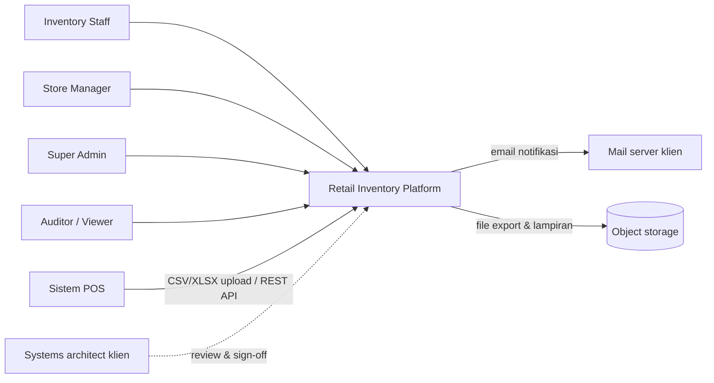
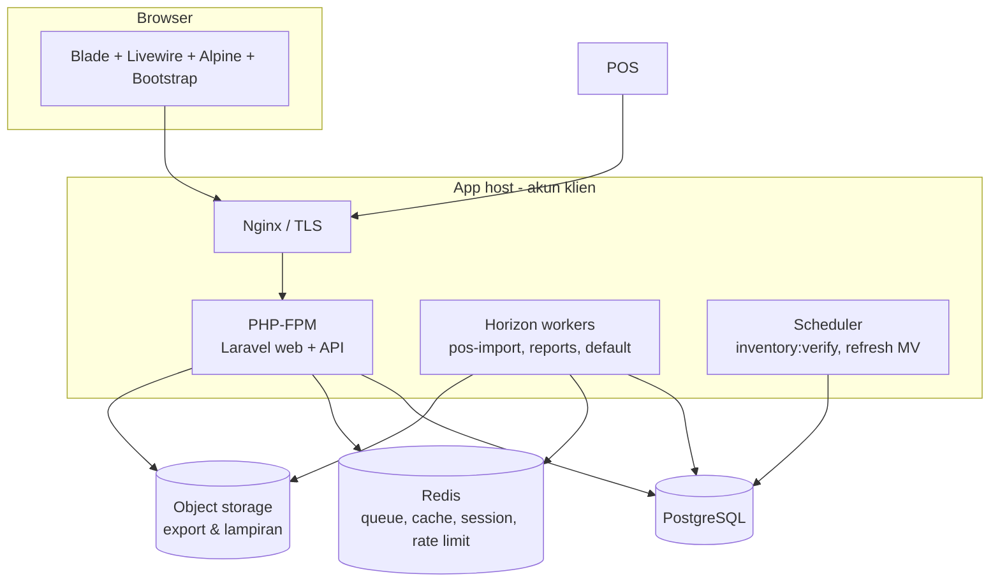
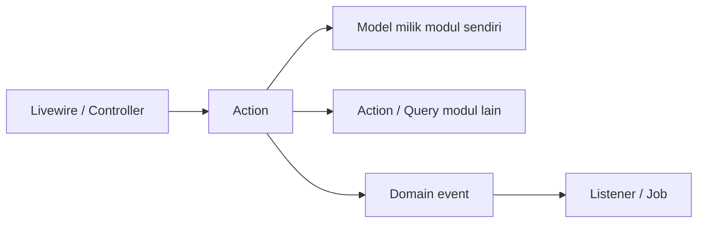
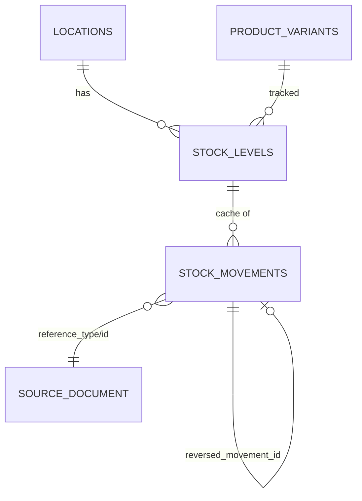
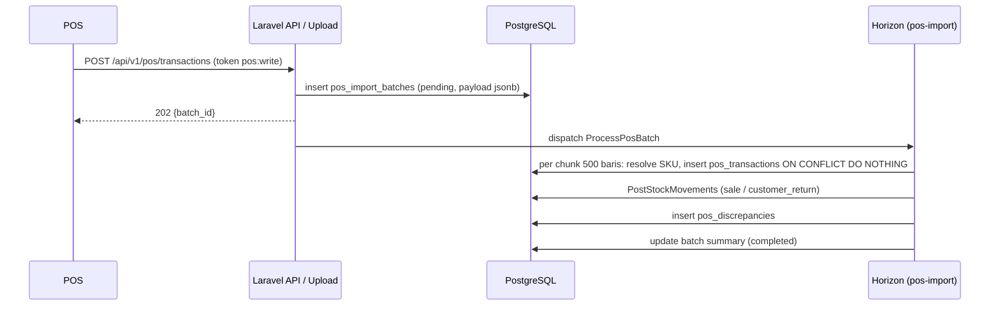
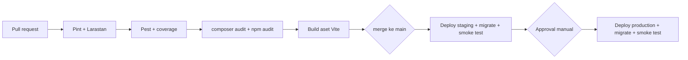
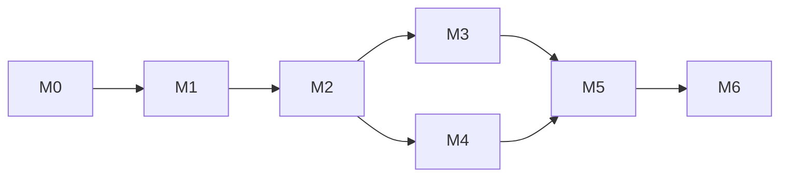

# Architecture & Implementation Plan — Retail Inventory Management Platform

| Item           | Detail                                                                                                   |
| -------------- | -------------------------------------------------------------------------------------------------------- |
| Dokumen acuan  | `PRD-retail-inventory.md` v0.2 (requirement, user story, NFR), `project-brief-retail-inventory.md`        |
| Tech stack     | Laravel · Livewire · Alpine.js · Bootstrap · PostgreSQL · Redis + Horizon (+ Python/FastAPI di Fase 5)    |
| Cakupan        | Arsitektur seluruh fase; rencana implementasi Fase 1 dirinci per task, Fase 2–7 per paket kerja          |
| Versi          | 0.2 — 6 November 2026 (ADR-001..009 di `docs/adr/`, ERD v1 di `docs/erd/`; tanpa komentar architect: proyek portfolio) |
| Status         | Direview di M0 (T0.06); persetujuan = merge PR oleh Salman (berperan sebagai architect)                   |

---

## 0. Cara Membaca Dokumen Ini

- **Bagian 1–9** menjelaskan arsitektur: bentuk sistem, aturan yang tidak boleh dilanggar, dan keputusan teknis yang harus dicatat.
- **Bagian 10** memecah Fase 1 menjadi task kecil (2–10 jam). Setiap task punya output, dependensi, estimasi, keterlacakan ke PRD, dan **kriteria selesai** yang bisa dicentang.
- **Bagian 11** memecah Fase 2–7 menjadi paket kerja dengan kriteria masuk dan keluar fase. Paket kerja ini dipecah lagi menjadi task di awal masing-masing fase, setelah pertanyaan scoping PRD §9 dijawab.
- **Bagian 12** berisi Definition of Done yang berlaku untuk **semua** task, di samping kriteria selesai spesifik per task.

### Konvensi

| Konvensi            | Arti                                                                                                   |
| ------------------- | ------------------------------------------------------------------------------------------------------ |
| `T{m}.{nn}`         | Task Fase 1 di milestone `m` (M0–M6), mis. `T2.05` = task ke-5 di milestone M2                         |
| `WP{f}.{n}`         | Paket kerja Fase `f` (2–7)                                                                             |
| `US-1.xx`           | User story di PRD §6.1.9                                                                               |
| `P-`, `D-`, `A-`, `B-`, `S-`, `L-`, `K-`, `Q-`, `O-`, `I-` | ID NFR di PRD §7.1                                              |
| `C-0x`              | Batasan kontrak di PRD §2.1                                                                            |
| `MG-0x`             | Prinsip migrasi di PRD §8.1                                                                            |
| `ADR-0xx`           | Architecture Decision Record di bagian 9                                                               |
| Estimasi            | Jam kerja efektif satu developer, termasuk test untuk task tersebut                                    |

---

## 1. Gambaran Sistem

### 1.1 Konteks



### 1.2 Container (Fase 1)



| Container            | Tanggung jawab                                                                 | Catatan                                                    |
| -------------------- | ------------------------------------------------------------------------------ | ---------------------------------------------------------- |
| Nginx                | TLS, HSTS, kompresi, limit ukuran upload                                       | Upload file POS ≤ 20 MB (disepakati di M0)                 |
| PHP-FPM (Laravel)    | UI Livewire, REST API, otorisasi, validasi                                     | Stateless; session di Redis                                |
| Horizon workers      | Import POS, laporan berat, notifikasi                                          | Queue terpisah agar import tidak menghambat laporan        |
| Scheduler            | Job terjadwal (lihat §3.6)                                                     | Satu instance saja (`onOneServer`)                          |
| PostgreSQL           | Data transaksi, ledger, materialized view                                      | Satu-satunya sumber kebenaran                              |
| Redis                | Queue, cache, session, rate limit                                              | Data di Redis boleh hilang tanpa merusak konsistensi stok  |
| Object storage       | File export, lampiran bukti, file POS asli                                      | S3-compatible atau disk lokal; diakses lewat signed URL    |

### 1.3 Evolusi container per fase

| Fase | Tambahan container / komponen                                                                                  |
| ---- | -------------------------------------------------------------------------------------------------------------- |
| 2    | Tidak ada container baru; modul Procurement & Batch di dalam monolith                                         |
| 3    | Laravel Reverb (WebSocket); PWA scanning (service worker + IndexedDB) disajikan oleh aplikasi yang sama        |
| 4    | Konektor POS per vendor sebagai modul di monolith; tabel outbox untuk sinkron keluar                          |
| 5    | Forecast service (Python + FastAPI) terpisah; skema `reporting` (atau TimescaleDB) untuk analitik              |
| 6    | Laravel Passport (OAuth2) untuk API publik; webhook dispatcher; konektor akuntansi & EDI                       |
| 7    | PostgreSQL HA + read replica; partisi ledger; observability stack; tenant isolation                           |

---

## 2. Arsitektur Aplikasi

### 2.1 Modular monolith

```
app/
├── Domain/
│   ├── Catalog/            # produk, varian, SKU, barcode, kategori, supplier, satuan
│   ├── Inventory/          # ledger, stock level, dokumen stok, saldo awal
│   ├── Pos/                # sumber POS, batch, transaksi, mapping SKU, discrepancy
│   ├── Reconciliation/     # stock count, variance, approval
│   ├── Reporting/          # query laporan, materialized view, export
│   └── Identity/           # user, role, lokasi, audit
│       ├── Actions/        # satu use case = satu class, method handle()
│       ├── Models/         # Eloquent model milik modul ini
│       ├── Enums/          # status, tipe movement, dll.
│       ├── Events/         # domain event
│       ├── Queries/        # read model untuk modul lain & laporan
│       ├── Policies/
│       └── Data/           # DTO input/output
├── Http/
│   ├── Livewire/{Modul}/   # komponen UI tipis, memanggil Action
│   ├── Controllers/Api/V1/ # REST API
│   ├── Requests/           # Form Request (validasi)
│   └── Resources/          # API Resource (bentuk respons)
└── Support/                # Quantity, Money, LocationScope, DocumentNumber, helpers
```

### 2.2 Aturan lapisan



| ID    | Aturan                                                                                                                                      |
| ----- | ------------------------------------------------------------------------------------------------------------------------------------------- |
| AR-01 | Livewire component dan controller hanya memvalidasi input, memanggil Action, dan menampilkan hasil. Tidak ada query tulis atau logika bisnis di sana. |
| AR-02 | Satu Action = satu use case, dibungkus `DB::transaction` bila menulis lebih dari satu baris.                                                 |
| AR-03 | Modul tidak menulis tabel milik modul lain. Interaksi lintas modul lewat Action atau Query class modul pemilik.                             |
| AR-04 | Satu-satunya jalan untuk mengubah stok adalah `Inventory\Actions\PostStockMovement` (dan `PostStockMovements` untuk dokumen multi-baris).   |
| AR-05 | Domain event di-dispatch **setelah commit** (`afterCommit`), agar listener tidak melihat data yang di-rollback.                             |
| AR-06 | Semua angka qty dan uang memakai value object `Quantity` / `Money` (berbasis string desimal), tidak pernah `float`.                         |
| AR-07 | Setiap model transaksional memakai `LocationScope`; bypass hanya lewat method eksplisit `withoutLocationScope()` yang dicatat di code review. |

### 2.3 Domain event utama

| Event                          | Dipicu oleh                         | Didengar oleh (Fase 1)                                   |
| ------------------------------ | ----------------------------------- | -------------------------------------------------------- |
| `StockMovementPosted`          | `PostStockMovement`                 | Penanda refresh dashboard; (Fase 4+) outbox sinkron      |
| `DocumentApproved`             | Approval adjustment, saldo awal, count | Audit log, notifikasi pembuat dokumen                 |
| `PosBatchProcessed`            | `ProcessPosBatch`                   | Notifikasi pengunggah, dashboard status import          |
| `PosDiscrepancyRaised`         | Detektor discrepancy                | Counter dashboard                                        |
| `StockCountSubmitted`          | Submit hasil hitung                 | Hitung variance & exception                              |
| `InventoryIntegrityFailed`     | `inventory:verify`                  | Alert ke Super Admin (O-01)                              |
| `ReportReady`                  | Job laporan                         | Notifikasi in-app dengan tautan unduh                    |

---

## 3. Arsitektur Data

### 3.1 Konvensi skema

| Aturan                    | Detail                                                                                          |
| ------------------------- | ----------------------------------------------------------------------------------------------- |
| Primary key               | `bigint generated always as identity`; nomor dokumen manusiawi di kolom terpisah (`number`)    |
| Qty                       | `numeric(14,3)`                                                                                  |
| Uang / biaya              | `numeric(14,4)`                                                                                  |
| Waktu                     | `timestamptz`, disimpan UTC; `occurred_at` (waktu bisnis) terpisah dari `created_at`            |
| Lokasi                    | Kolom `location_id` wajib di setiap tabel transaksional (FR1.7)                                  |
| Foreign key               | Selalu didefinisikan; `on delete restrict` untuk data transaksi, tidak ada cascade ke ledger     |
| Status                    | `varchar` + PHP enum + `CHECK` constraint                                                        |
| Soft delete               | Hanya untuk master data; dokumen yang sudah diposting tidak pernah dihapus                      |
| Payload eksternal         | `jsonb` (mis. payload POS mentah)                                                                |
| Migration                 | Satu perubahan logis per file, wajib punya `down()` yang teruji                                  |

### 3.2 Ledger stok



- `stock_movements` **append-only**: trigger `BEFORE UPDATE OR DELETE` me-raise exception. User database aplikasi tidak punya hak `TRUNCATE`.
- `stock_levels` adalah cache `(location_id, product_variant_id)` unik, berisi `on_hand`, `avg_cost`, `last_movement_id`.
- **Alur posting** (`PostStockMovements`):
  1. Urutkan baris berdasarkan `product_variant_id` (mencegah deadlock).
  2. `INSERT ... ON CONFLICT DO NOTHING` baris `stock_levels` yang belum ada, lalu `SELECT ... FOR UPDATE`.
  3. Validasi stok negatif sesuai jenis dokumen (PRD §6.1.4 aturan 6).
  4. Insert movement dengan `balance_after`, hitung ulang `avg_cost` untuk movement masuk.
  5. Update `stock_levels`, commit, dispatch `StockMovementPosted` setelah commit.
- **Saldo per tanggal** = `SUM(quantity) WHERE occurred_at <= :t` dengan index `(location_id, product_variant_id, occurred_at)`.
- **Verifikasi** `inventory:verify`: bandingkan `stock_levels.on_hand` dengan agregat ledger; selisih ≠ 0 memicu `InventoryIntegrityFailed`.

### 3.3 Dokumen stok

Semua dokumen (penerimaan, transfer, retur, adjustment, saldo awal, stock count) mengikuti pola yang sama:

| Komponen         | Detail                                                                                 |
| ---------------- | -------------------------------------------------------------------------------------- |
| Header + items   | `{doc}` dan `{doc}_items`                                                              |
| Nomor            | `DocumentNumber` per tipe & lokasi, mis. `GR-LOC01-2026-000123`, dikunci di level DB   |
| Status           | Enum + method transisi yang memvalidasi status asal (state machine)                     |
| Approval         | Trait `RequiresApproval`: menyimpan `created_by`, `approved_by`, menolak bila sama (R-02) |
| Posting          | Satu panggilan `PostStockMovements` untuk seluruh baris (atomik)                        |
| Audit            | Setiap transisi status tercatat di audit log                                           |

### 3.4 Materialized view & laporan

| View                      | Isi                                              | Refresh                                      |
| ------------------------- | ------------------------------------------------ | -------------------------------------------- |
| `mv_daily_stock_summary`  | Saldo & nilai per lokasi, SKU, tanggal           | Tiap 5 menit, `REFRESH ... CONCURRENTLY` (P-07) |
| `mv_movement_by_type`     | Agregat movement per lokasi, tipe, hari          | Tiap 5 menit                                 |

`REFRESH ... CONCURRENTLY` membutuhkan unique index di setiap view; index ini dibuat di migration yang sama.

### 3.5 Pertumbuhan data

| Tabel              | Perkiraan Fase 1 (1 toko, 5.000 trx/hari, ~3 baris/trx) | Rencana                                                      |
| ------------------ | ------------------------------------------------------- | ------------------------------------------------------------ |
| `stock_movements`  | ±5,5 juta baris/tahun                                   | Index komposit cukup di Fase 1–3; partisi per bulan di Fase 7 |
| `pos_transaction_lines` | ±5,5 juta baris/tahun                              | Sama                                                          |
| `activity_log`     | ±1–2 juta baris/tahun                                   | Retensi sesuai L-01, arsip setelahnya                         |

### 3.6 Job terjadwal

| Job                                   | Jadwal                    | Tujuan                                   |
| ------------------------------------- | ------------------------- | ---------------------------------------- |
| `inventory:verify`                    | Harian 02:00 waktu lokasi | Integritas ledger (D-01)                 |
| `reporting:refresh-views`             | Tiap 5 menit              | Kesegaran dashboard (P-07)               |
| `horizon:snapshot`                    | Tiap 5 menit              | Metrik queue                             |
| `exports:prune`                       | Harian                    | Hapus file export > 7 hari               |
| `auth:prune-sessions` / token expired | Harian                    | Kebersihan sesi                          |
| Backup database                       | Sesuai ADR-006            | B-01 s.d. B-03                           |

---

## 4. Arsitektur Integrasi POS



| Aturan  | Detail                                                                                                         |
| ------- | -------------------------------------------------------------------------------------------------------------- |
| IN-01   | Idempotensi file: hash SHA-256 unik per `pos_source_id`. Idempotensi transaksi: `UNIQUE (pos_source_id, location_id, external_id)` |
| IN-02   | File dibaca secara streaming per chunk 500 baris; satu chunk = satu transaksi DB                               |
| IN-03   | Urutan resolusi SKU: barcode → SKU varian → `sku_mappings`                                                     |
| IN-04   | Transaksi dengan `occurred_at` sebelum cutover timestamp lokasi diabaikan dan dicatat (MG-03)                  |
| IN-05   | Job bisa diulang (retry) tanpa efek ganda; batch menyimpan offset chunk terakhir yang sukses                   |
| IN-06   | API: Sanctum token per sumber POS, ability `pos:write`, rate limit per token, respons 202                      |
| IN-07   | Payload mentah selalu disimpan untuk audit dan pemrosesan ulang setelah mapping SKU diperbaiki                 |

---

## 5. Arsitektur Keamanan

| Area              | Implementasi                                                                                                         | NFR / PRD          |
| ----------------- | -------------------------------------------------------------------------------------------------------------------- | ------------------ |
| Autentikasi web   | Laravel Fortify: login, reset password, rule password ≥ 12 + `uncompromised()`, throttle 5 gagal / 15 menit           | S-03, US-1.22      |
| 2FA               | Fortify TOTP; middleware `EnsureTwoFactorEnabled` untuk role Super Admin & Store Manager                              | S-03               |
| Sesi              | Driver Redis; idle 30 menit (`SESSION_LIFETIME`), absolute 12 jam lewat middleware; invalidasi saat user dinonaktifkan | S-04, US-1.24      |
| API               | Sanctum token per sumber POS dengan ability; hash token disimpan, nilai mentah hanya ditampilkan sekali              | IN-06              |
| Otorisasi         | `spatie/laravel-permission` (permission per aksi, PRD §4.3) + Policy per model + cek segregasi tugas                 | R-02, R-03         |
| Scope lokasi      | Pivot `location_user` + global `LocationScope` + Policy; data di luar lokasi user → 404                               | R-01, S-06         |
| Audit             | `spatie/laravel-activitylog` untuk perubahan model + log eksplisit untuk login, approval, token; tabel tanpa update/delete dari aplikasi | L-01, US-1.25 |
| Header & transport| TLS 1.2+, HSTS, CSP dasar, `X-Frame-Options`, cookie `Secure` `HttpOnly` `SameSite=Lax`                              | S-01               |
| Input & output    | Form Request, query builder dengan binding, escape Blade, escape formula pada export CSV/XLSX                       | S-02, US-1.21      |
| Secret            | `.env` tidak di-commit; secret produksi di secret manager / environment milik klien                                  | C-03, C-04         |
| Dependensi        | `composer audit` & `npm audit` di CI, gagal bila ada high/critical                                                   | S-05               |
| Database          | User aplikasi tanpa hak DDL di produksi; migration dijalankan user terpisah saat deploy                              | D-01               |

---

## 6. Arsitektur Frontend

| Aspek                 | Keputusan                                                                                                                     |
| --------------------- | ----------------------------------------------------------------------------------------------------------------------------- |
| Rendering             | Blade + Livewire (full-page components untuk layar utama)                                                                     |
| Styling               | Bootstrap via Vite (Sass), theming lewat variabel Sass; tidak ada Tailwind                                                    |
| Interaksi lokal       | Alpine.js (sudah dibundel Livewire)                                                                                           |
| Widget JS Bootstrap   | Modal, dropdown, toast, tooltip dikendalikan Alpine (`x-data` + `bootstrap.Modal.getOrCreateInstance`) atau dibungkus `wire:ignore`; dilarang `data-bs-toggle` di elemen yang di-morph Livewire |
| Komponen bersama      | `resources/views/components/`: `x-layout`, `x-card`, `x-table`, `x-modal`, `x-form.*`, `x-badge-status`, `x-empty-state`, `x-toast` |
| Pagination            | `WithPagination` + `$paginationTheme = 'bootstrap'`                                                                           |
| Scanner               | Input fokus otomatis; scanner HID diperlakukan sebagai ketikan + Enter; debounce 50 ms                                       |
| Chart                 | ApexCharts lewat komponen Alpine yang menerima data dari Livewire                                                             |
| Responsif             | Desktop ≥ 1280 px; layar stock count & cek stok dioptimalkan untuk tablet ≥ 768 px (K-02)                                     |
| Navigasi              | Menu dibangun dari permission user; item tanpa izin tidak dirender                                                            |

---

## 7. Lingkungan, CI/CD & Operasional

### 7.1 Lingkungan

| Lingkungan  | Tujuan                                          | Data                                   | Siapa yang deploy                 |
| ----------- | ----------------------------------------------- | -------------------------------------- | --------------------------------- |
| Local       | Development (Docker: app, PostgreSQL, Redis, Mailpit) | Seeder demo                       | Developer                         |
| Staging     | Demo milestone, UAT, load test, rehearsal migrasi | Sample data ukuran target (C-05)     | Otomatis dari branch `main`       |
| Production  | Toko live (setelah otorisasi C-05)              | Data riil                              | Manual dengan approval di pipeline |

Semua lingkungan non-lokal berada di akun cloud milik klien (C-03).

### 7.2 Pipeline CI/CD



| Aturan  | Detail                                                                                          |
| ------- | ----------------------------------------------------------------------------------------------- |
| CD-01   | Branch `main` terlindungi; merge hanya lewat PR dengan CI hijau dan 1 review                    |
| CD-02   | Migration harus backward-compatible dengan kode versi sebelumnya (expand → migrate → contract)  |
| CD-03   | Deploy tanpa downtime: build aset dulu, `php artisan migrate --force`, reload PHP-FPM, `horizon:terminate` |
| CD-04   | Setiap deploy produksi didahului snapshot database                                              |
| CD-05   | Smoke test setelah deploy: login, buka dashboard, health check `/up`, Horizon aktif             |

### 7.3 Observability

| Sinyal            | Alat                                                       | Alert                                                      |
| ----------------- | ---------------------------------------------------------- | ---------------------------------------------------------- |
| Error aplikasi    | Error tracker (Sentry atau setara yang disetujui klien)    | Error baru di produksi                                     |
| Queue             | Horizon dashboard + metrik                                 | Job gagal; antrian > 10 menit (O-01)                       |
| Integritas        | `inventory:verify`                                         | Selisih ≠ 0 (D-01)                                         |
| Uptime            | Uptime monitor eksternal pada `/up`                        | Down > 2 menit pada jam operasional (A-01)                 |
| Log               | Laravel log terstruktur (JSON), rotasi harian              | —                                                          |

---

## 8. Strategi Testing

| Lapisan                 | Alat                                    | Cakupan                                                                       | Kapan dijalankan        |
| ----------------------- | --------------------------------------- | ----------------------------------------------------------------------------- | ----------------------- |
| Unit                    | Pest                                    | Value object, kalkulasi variance, avg cost, resolver SKU, state machine        | Setiap PR               |
| Feature                 | Pest (database PostgreSQL asli)         | Satu test per acceptance criteria US-1.xx; permission & scope lokasi           | Setiap PR               |
| Integritas & concurrency | Pest + proses paralel                  | Posting bersamaan, `inventory:verify` setelah skenario penuh                   | Setiap PR yang menyentuh stok |
| API contract            | Pest + skema OpenAPI                    | Bentuk request/response API v1                                                 | Setiap PR               |
| Browser                 | Pest browser testing (Playwright) atau Dusk (ADR-007) | Alur kritis: penerimaan, import POS, stock count, approval       | Harian di staging       |
| Load / NFR              | k6                                      | P-01 s.d. P-06                                                                 | Akhir M3, M5, M6        |
| Keamanan                | OWASP ZAP + review manual               | S-02, S-06                                                                     | M6 dan sebelum go-live  |

Test feature memakai **PostgreSQL**, bukan SQLite, karena trigger, `FOR UPDATE`, `jsonb`, dan materialized view harus teruji dengan engine yang sama dengan produksi.

---

## 9. Architecture Decision Records

Setiap keputusan dicatat di `docs/adr/` dengan format: konteks, opsi, keputusan, konsekuensi. ADR yang statusnya *Usulan* disepakati di M0.

| ADR     | Keputusan                                                          | Status      |
| ------- | ------------------------------------------------------------------ | ----------- |
| ADR-001 | Modular monolith Laravel, bukan microservice                       | Usulan      |
| ADR-002 | Ledger immutable + `stock_levels` sebagai cache                    | Usulan      |
| ADR-003 | Scope lokasi: pivot `location_user` + global scope + Policy (bukan fitur *teams* Spatie) | Usulan |
| ADR-004 | UI Livewire + Bootstrap; aturan widget JS Bootstrap (§6)           | Disetujui (PRD v0.2) |
| ADR-005 | Redis + Horizon untuk queue, cache, session                        | Usulan      |
| ADR-006 | Hosting, backup & PITR (managed PostgreSQL vs VPS + WAL-G/pgBackRest) | Menunggu pilihan hosting klien |
| ADR-007 | Alat browser testing (Pest browser/Playwright vs Dusk)              | Usulan      |
| ADR-008 | Costing weighted average di Fase 1; FIFO lewat `cost_layers` di Fase 2 | Usulan   |
| ADR-009 | Versi Laravel, PHP, Livewire, Bootstrap, PostgreSQL dikunci saat M0 | Usulan     |
| ADR-010 | Outbox pattern untuk sinkron keluar (Fase 4+)                      | Ditunda ke Fase 4 |
| ADR-011 | Kontrak forecast service (Fase 5)                                  | Ditunda ke Fase 5 |
| ADR-012 | Strategi multi-tenant (Fase 7)                                     | Ditunda ke Fase 7 |

---

## 10. Rencana Implementasi Fase 1

### 10.1 Ringkasan milestone

| Milestone                           | Minggu | Task         | Estimasi | Deliverable klien |
| ----------------------------------- | ------ | ------------ | -------- | ----------------- |
| M0 — Discovery & Architecture       | 1      | T0.01–T0.09  | 33 jam   | #1, #2, #7        |
| M1 — Foundation & Master Data       | 2–3    | T1.01–T1.14  | 66 jam   | #3                |
| M2 — Inventory Ledger               | 4–5    | T2.01–T2.12  | 64 jam   | #4 (bagian 1)     |
| M3 — POS Integration                | 6–7    | T3.01–T3.12  | 57 jam   | —                 |
| M4 — Stock Count & Reconciliation   | 8–9    | T4.01–T4.10  | 50 jam   | #4 (bagian 2)     |
| M5 — Dashboard & Reports            | 10–11  | T5.01–T5.09  | 53 jam   | #5                |
| M6 — Hardening & Handover           | 12     | T6.01–T6.07  | 33 jam   | #6                |
| **Total**                           |        | **73 task**  | **356 jam** | (PRD: 310–400 jam) |



M3 dan M4 sama-sama bergantung pada M2. Dengan dua developer, keduanya bisa dikerjakan paralel; satu-satunya titik temu adalah T4.10 (skenario demo rekonsiliasi), yang memakai seeder penjualan T3.12 dan karena itu dikerjakan paling akhir di M4.

### 10.2 Gate milestone

Sebuah milestone dianggap selesai jika:

1. Semua task di milestone itu memenuhi kriteria selesai masing-masing dan Definition of Done global (§12).
2. Demo dengan sample data di **staging** sudah dilakukan ke klien dan systems architect (C-05, C-06).
3. Catatan sign-off tertulis dari architect tersimpan di `docs/milestones/M{n}.md`, berisi scope vs hasil, bukti test, dan isu terbuka.
4. Isu dengan severity high dari review architect sudah diselesaikan atau dijadwalkan dengan persetujuan tertulis.

---

### 10.3 M0 — Discovery & Architecture (33 jam)

#### T0.01 — Kickoff & validasi pertanyaan Fase 1
- **Output:** Notulen kickoff; jawaban 10 pertanyaan validasi PRD §6.1.11.
- **Bergantung pada:** NDA ditandatangani (C-01).
- **Estimasi:** 3 jam · **Traceability:** PRD §6.1.11, §13
- **Selesai jika:**
  - [ ] Setiap pertanyaan punya jawaban atau ditandai "menunggu klien" dengan nama PIC dan tanggal target.
  - [ ] Jawaban yang mengubah scope sudah dicatat sebagai perubahan di PRD (versi naik).
  - [ ] Contoh file export POS (minimal 1 hari transaksi, boleh disamarkan) sudah diterima, atau risikonya dicatat.

#### T0.02 — Kesepakatan target NFR & ADR awal
- **Output:** Tabel NFR PRD §7.1 berstatus "disepakati"; ADR-001 s.d. ADR-009 di `docs/adr/`.
- **Bergantung pada:** T0.01
- **Estimasi:** 4 jam · **Traceability:** PRD §7.1, §9 dokumen ini
- **Selesai jika:**
  - [ ] Setiap target NFR Fase 1 disetujui architect atau diubah dengan angka baru yang disetujui.
  - [ ] ADR-001 s.d. ADR-009 berstatus Disetujui, kecuali ADR-006 yang boleh menunggu pilihan hosting dengan tanggal keputusan.
  - [ ] Versi Laravel, PHP, Livewire, Bootstrap, dan PostgreSQL tercatat di ADR-009.

#### T0.03 — Repository di akun klien
- **Output:** Repo di organisasi milik klien dengan proteksi branch, template PR, `CODEOWNERS`, dan `.gitignore`.
- **Bergantung pada:** Akun klien tersedia (C-03)
- **Estimasi:** 2 jam · **Traceability:** C-02, C-03, CD-01
- **Selesai jika:**
  - [ ] Developer hanya berstatus kolaborator; pemilik organisasi adalah klien.
  - [ ] Push langsung ke `main` ditolak; merge butuh CI hijau dan 1 review.
  - [ ] Template PR berisi checklist Definition of Done (§12).

#### T0.04 — Kerangka project & environment lokal
- **Output:** Project Laravel dengan struktur modul §2.1, Docker lokal (app, PostgreSQL, Redis, Mailpit), Livewire, Bootstrap via Vite.
- **Bergantung pada:** T0.02, T0.03
- **Estimasi:** 5 jam · **Traceability:** ADR-001, ADR-004, ADR-009
- **Selesai jika:**
  - [ ] `git clone` + satu perintah setup (`make setup` atau setara) menghasilkan aplikasi berjalan di lokal dalam ≤ 15 menit.
  - [ ] Halaman contoh Livewire dengan komponen Bootstrap (modal via Alpine) berfungsi tanpa error console.
  - [ ] `.env.example` lengkap tanpa secret riil; README berisi langkah setup.

#### T0.05 — Pipeline CI
- **Output:** Workflow CI: Pint, Larastan (level ≥ 6), Pest dengan PostgreSQL, coverage, `composer audit`, `npm audit`, build Vite.
- **Bergantung pada:** T0.04
- **Estimasi:** 4 jam · **Traceability:** Q-01, S-05, CD-01
- **Selesai jika:**
  - [ ] PR dengan pelanggaran Pint, Larastan, test gagal, atau kerentanan high/critical membuat CI merah.
  - [ ] Laporan coverage tersedia sebagai artefak CI.
  - [ ] Waktu CI ≤ 10 menit untuk kode kosong.

#### T0.06 — Dokumen arsitektur & ERD v1
- **Output:** Dokumen ini direview; ERD Fase 1 (diagram + daftar tabel & kolom) di `docs/erd/`.
- **Bergantung pada:** T0.02
- **Estimasi:** 4 jam · **Traceability:** Deliverable klien #1
- **Selesai jika:**
  - [ ] ERD mencakup seluruh tabel PRD §6.1.6 dengan tipe kolom, FK, unique, dan index utama.
  - [ ] Komentar architect terhadap dokumen ini sudah dijawab dan versinya naik ke 0.2.

#### T0.07 — Rencana sample data
- **Output:** Spesifikasi sample data: jumlah lokasi, kategori, SKU, rentang hari penjualan, dan daftar skenario sengaja (selisih, duplikat, SKU tak dikenal, dll.).
- **Bergantung pada:** T0.01
- **Estimasi:** 2 jam · **Traceability:** C-05, PRD §6.1.12
- **Selesai jika:**
  - [ ] Setiap jenis discrepancy POS dan setiap skenario exception stock count punya minimal satu kasus di spesifikasi.
  - [ ] Volume sample data sama dengan asumsi NFR (10.000 SKU, 5.000 trx/hari) untuk load test.

#### T0.08 — Proposal budget & timeline
- **Output:** Dokumen proposal: estimasi jam per milestone, rate, termin pembayaran, asumsi, dan yang di luar scope.
- **Bergantung pada:** T0.01, T0.02
- **Estimasi:** 3 jam · **Traceability:** Deliverable klien #7
- **Selesai jika:**
  - [ ] Angka jam konsisten dengan §10.1 dokumen ini.
  - [ ] Proposal disetujui klien atau perubahan dicatat sebagai revisi.

#### T0.09 — Staging & deploy otomatis
- **Output:** Server staging di akun klien (app, PostgreSQL, Redis, object storage), deploy otomatis dari `main`, HTTPS aktif.
- **Bergantung pada:** T0.05, ADR-006 (minimal pilihan provider)
- **Estimasi:** 6 jam · **Traceability:** §7.1, C-03, CD-03, CD-05
- **Selesai jika:**
  - [ ] Merge ke `main` ter-deploy ke staging otomatis dan smoke test (CD-05) lulus.
  - [ ] Skor SSL Labs minimal A; HSTS aktif.
  - [ ] Secret staging hanya ada di environment server, tidak di repo.

---

### 10.4 M1 — Foundation & Master Data (66 jam)

#### T1.01 — Value object Quantity & Money
- **Output:** `Support\Quantity`, `Support\Money` berbasis string desimal + cast Eloquent.
- **Bergantung pada:** T0.04
- **Estimasi:** 3 jam · **Traceability:** AR-06
- **Selesai jika:**
  - [ ] Operasi tambah, kurang, kali, bandingkan, dan pembulatan teruji termasuk nilai negatif dan 3 desimal.
  - [ ] `0.1 + 0.2` menghasilkan tepat `0.3`.
  - [ ] Larastan menolak penugasan `float` ke kolom qty/uang di model.

#### T1.02 — Lokasi & scope lokasi
- **Output:** Tabel `locations` (termasuk zona waktu & jam operasional), `location_user`; `LocationScope`; trait `BelongsToLocation`; helper `withoutLocationScope()`.
- **Bergantung pada:** T0.04
- **Estimasi:** 5 jam · **Traceability:** FR1.7, R-01, AR-07, ADR-003, I-01
- **Selesai jika:**
  - [ ] Query model ber-`BelongsToLocation` otomatis terfilter ke lokasi user yang login.
  - [ ] Akses langsung ke ID milik lokasi lain lewat route model binding menghasilkan 404.
  - [ ] Job queue & command berjalan dengan konteks lokasi eksplisit dan tidak bocor ke lokasi lain (ada test).
  - [ ] Waktu tersimpan UTC dan ditampilkan sesuai zona waktu lokasi (I-01).

#### T1.03 — Autentikasi
- **Output:** Fortify: login, logout, reset password, verifikasi email, rule password, throttle, idle & absolute timeout.
- **Bergantung pada:** T0.04
- **Estimasi:** 6 jam · **Traceability:** US-1.22, S-03, S-04
- **Selesai jika:**
  - [ ] Password < 12 karakter atau yang ada di daftar password bocor ditolak.
  - [ ] 5 kali gagal dalam 15 menit mengunci login sementara dan tercatat di audit log (US-1.22 AC2).
  - [ ] Sesi berakhir setelah 30 menit idle dan setelah 12 jam absolut (test dengan waktu dimanipulasi).

#### T1.04 — RBAC & segregasi tugas
- **Output:** Seeder permission & role sesuai matriks PRD §4.3; base Policy; helper `AssertNotSameActor`.
- **Bergantung pada:** T1.02
- **Estimasi:** 6 jam · **Traceability:** PRD §4, R-02, R-03, R-04
- **Selesai jika:**
  - [ ] Test berbasis data membuktikan setiap sel matriks PRD §4.3 (izin dan larangan) untuk kelima role.
  - [ ] Perubahan role/permission oleh Super Admin berlaku tanpa deploy.
  - [ ] Helper segregasi menolak approval oleh pembuat dokumen (dipakai ulang di T2.04, T4.08).

#### T1.05 — 2FA wajib
- **Output:** TOTP Fortify, halaman setup & recovery code, middleware `EnsureTwoFactorEnabled`.
- **Bergantung pada:** T1.03, T1.04
- **Estimasi:** 4 jam · **Traceability:** US-1.22 AC1, S-03
- **Selesai jika:**
  - [ ] User Super Admin/Store Manager tanpa 2FA hanya bisa membuka halaman setup 2FA.
  - [ ] Recovery code bisa dipakai sekali dan tercatat di audit log.

#### T1.06 — Shell UI & komponen Bootstrap
- **Output:** Layout, sidebar berbasis permission, pemilih lokasi, komponen `x-card`, `x-table`, `x-modal`, `x-form.*`, `x-toast`, `x-badge-status`, `x-empty-state`.
- **Bergantung pada:** T0.04, T1.04
- **Estimasi:** 6 jam · **Traceability:** §6 dokumen ini, ADR-004, K-02
- **Selesai jika:**
  - [ ] Modal dan dropdown tetap berfungsi setelah komponen Livewire di sekitarnya re-render (test browser).
  - [ ] Menu tanpa izin tidak dirender untuk setiap role.
  - [ ] Layout bisa dipakai di lebar 768 px dan 1280 px tanpa scroll horizontal.

#### T1.07 — Fondasi audit log
- **Output:** Konfigurasi activitylog, logger eksplisit untuk event auth & approval, proteksi tabel dari update/delete.
- **Bergantung pada:** T0.04
- **Estimasi:** 5 jam · **Traceability:** FR1.6, US-1.25 AC1, L-01
- **Selesai jika:**
  - [ ] Setiap entri berisi pelaku, waktu, IP, aksi, subjek, dan nilai sebelum/sesudah bila ada.
  - [ ] Tidak ada route atau Action yang bisa mengubah atau menghapus entri audit (ada test).
  - [ ] Data sensitif (password, token, secret 2FA) tidak pernah masuk ke log.

#### T1.08 — Administrasi user, role & lokasi
- **Output:** Layar Livewire untuk user (buat, nonaktifkan, assign role & lokasi), role & permission, lokasi.
- **Bergantung pada:** T1.04, T1.06
- **Estimasi:** 5 jam · **Traceability:** US-1.24
- **Selesai jika:**
  - [ ] US-1.24 AC1 & AC2 lolos sebagai feature test.
  - [ ] User yang dinonaktifkan langsung keluar dari semua sesi aktif.
  - [ ] Perubahan tercatat di audit log dengan nilai sebelum & sesudah.

#### T1.09 — Skema katalog
- **Output:** Migration `categories`, `brands`, `suppliers`, `units`, `products`, `product_variants`, `variant_attributes`, `barcodes`, `variant_location_settings` + model & factory.
- **Bergantung pada:** T0.06, T1.01
- **Estimasi:** 5 jam · **Traceability:** FR1.1, PRD §6.1.6
- **Selesai jika:**
  - [ ] Unique constraint di database untuk SKU dan barcode.
  - [ ] Semua migration bisa `migrate:fresh` dan `migrate:rollback` tanpa error.
  - [ ] ERD di `docs/erd/` sama dengan skema hasil migration.

#### T1.10 — Produk & varian
- **Output:** Layar daftar & form produk dengan atribut varian, generator SKU, status SKU.
- **Bergantung pada:** T1.06, T1.09
- **Estimasi:** 6 jam · **Traceability:** US-1.01
- **Selesai jika:**
  - [ ] US-1.01 AC1–AC4 lolos sebagai feature test.
  - [ ] Daftar produk 10.000 SKU dengan filter & pencarian memenuhi P-01.

#### T1.11 — Barcode & pencarian scanner
- **Output:** Kelola banyak barcode per varian; komponen pencarian yang menerima input scanner.
- **Bergantung pada:** T1.10
- **Estimasi:** 4 jam · **Traceability:** US-1.03, P-02, K-03
- **Selesai jika:**
  - [ ] US-1.03 AC1–AC2 lolos.
  - [ ] Pencarian barcode memenuhi P-02 pada 10.000 SKU.
  - [ ] Uji manual dengan scanner HID untuk EAN-13, UPC-A, dan Code 128 lulus.

#### T1.12 — Import massal produk
- **Output:** Upload CSV → preview (valid/tidak valid + alasan) → konfirmasi → simpan; unduh file baris gagal.
- **Bergantung pada:** T1.10
- **Estimasi:** 6 jam · **Traceability:** US-1.02, P-05, MG-04
- **Selesai jika:**
  - [ ] US-1.02 AC1–AC3 lolos.
  - [ ] Preview tidak menulis apa pun ke database.
  - [ ] Import yang sama diulang tidak membuat produk duplikat.

#### T1.13 — Reorder point per lokasi
- **Output:** Form pengaturan reorder point & minimum per SKU per lokasi (satuan dan massal).
- **Bergantung pada:** T1.10
- **Estimasi:** 2 jam · **Traceability:** US-1.04
- **Selesai jika:**
  - [ ] Nilai tersimpan per lokasi dan hanya bisa diubah role yang diizinkan PRD §4.3.
  - [ ] Query "di bawah reorder point" tersedia sebagai Query class untuk dipakai dashboard (T5.02).

#### T1.14 — Seeder dasar
- **Output:** Seeder deterministik: lokasi, user per role, katalog sesuai spesifikasi T0.07.
- **Bergantung pada:** T0.07, T1.09
- **Estimasi:** 3 jam · **Traceability:** C-05, Deliverable klien #3
- **Selesai jika:**
  - [ ] `php artisan migrate:fresh --seed` menghasilkan data yang identik di setiap run (seed tetap).
  - [ ] Tidak ada nama merek, toko, atau orang riil.
  - [ ] Demo prototype database (Deliverable #3) bisa dijalankan dari data ini.

**Gate M1:** prototype database dan master data didemokan; architect menyetujui skema dan matriks RBAC.

---

### 10.5 M2 — Inventory Ledger (64 jam)

#### T2.01 — Skema ledger
- **Output:** Migration `stock_levels`, `stock_movements`, `reason_codes`; trigger anti update/delete; `CHECK (quantity <> 0)`; index komposit.
- **Bergantung pada:** T1.09
- **Estimasi:** 5 jam · **Traceability:** FR1.2, PRD §6.1.4, ADR-002
- **Selesai jika:**
  - [ ] `UPDATE` atau `DELETE` langsung ke `stock_movements` gagal di level database (test SQL mentah).
  - [ ] `EXPLAIN` query saldo per tanggal memakai index `(location_id, product_variant_id, occurred_at)`.
  - [ ] Enum tipe movement di PHP sama dengan `CHECK` di database.

#### T2.02 — Action posting & reversal
- **Output:** `PostStockMovement`, `PostStockMovements`, `ReverseStockMovement` sesuai alur §3.2.
- **Bergantung pada:** T2.01
- **Estimasi:** 8 jam · **Traceability:** FR1.2, AR-04, AR-05, US-1.10
- **Selesai jika:**
  - [ ] `balance_after`, `on_hand`, dan `avg_cost` benar untuk skenario masuk, keluar, dan reversal (unit test dengan angka tertulis).
  - [ ] Dokumen manual yang membuat stok negatif ditolak; penjualan POS yang membuat stok negatif diterima (PRD §6.1.4 aturan 6).
  - [ ] US-1.10 AC1–AC2 lolos.
  - [ ] Event `StockMovementPosted` tidak terkirim bila transaksi di-rollback.

#### T2.03 — Integritas & concurrency
- **Output:** Command `inventory:verify`, jadwal harian, event `InventoryIntegrityFailed` + notifikasi; test concurrency.
- **Bergantung pada:** T2.02
- **Estimasi:** 6 jam · **Traceability:** US-1.11, D-01, O-01
- **Selesai jika:**
  - [ ] Test 2 proses paralel × 100 posting pada SKU yang sama menghasilkan saldo benar tanpa deadlock.
  - [ ] Selisih yang disuntikkan secara sengaja terdeteksi dan memicu notifikasi Super Admin.
  - [ ] `inventory:verify` pada 5 juta movement selesai ≤ 2 menit.

#### T2.04 — Kerangka dokumen stok
- **Output:** Trait/abstraksi header-items, `DocumentNumber`, state machine dasar, `RequiresApproval`, audit transisi.
- **Bergantung pada:** T1.04, T1.07, T2.02
- **Estimasi:** 4 jam · **Traceability:** §3.3, R-02
- **Selesai jika:**
  - [ ] Nomor dokumen unik dan berurutan per tipe & lokasi meski dibuat bersamaan (test paralel).
  - [ ] Transisi status yang tidak valid melempar exception.
  - [ ] Approval oleh pembuat dokumen ditolak.

#### T2.05 — Penerimaan barang
- **Output:** Layar & Action penerimaan barang (input manual + scan), lampiran bukti opsional.
- **Bergantung pada:** T2.04, T1.11
- **Estimasi:** 6 jam · **Traceability:** US-1.05
- **Selesai jika:**
  - [ ] US-1.05 AC1–AC3 lolos.
  - [ ] SKU `discontinued` ditolak (US-1.01 AC4).

#### T2.06 — Transfer antar lokasi
- **Output:** Dokumen transfer dengan status draft → in_transit → received, penerimaan parsial & selisih.
- **Bergantung pada:** T2.04
- **Estimasi:** 7 jam · **Traceability:** US-1.06
- **Selesai jika:**
  - [ ] US-1.06 AC1–AC3 lolos.
  - [ ] User lokasi asal tidak bisa melihat dokumen lokasi tujuan selain transfer itu sendiri.

#### T2.07 — Retur pelanggan & supplier
- **Output:** Dokumen retur dua arah dengan supplier & alasan wajib untuk retur supplier.
- **Bergantung pada:** T2.04
- **Estimasi:** 4 jam · **Traceability:** US-1.07
- **Selesai jika:**
  - [ ] US-1.07 AC1–AC2 lolos.

#### T2.08 — Adjustment dengan approval
- **Output:** Draft → submit → approve/reject, reason code wajib, notifikasi ke approver.
- **Bergantung pada:** T2.04
- **Estimasi:** 6 jam · **Traceability:** US-1.08
- **Selesai jika:**
  - [ ] US-1.08 AC1–AC4 lolos.
  - [ ] Daftar adjustment menunggu approval tampil untuk Store Manager lokasinya.

#### T2.09 — Layar reversal
- **Output:** Aksi reversal di detail movement/dokumen dengan alasan wajib.
- **Bergantung pada:** T2.02, T2.04
- **Estimasi:** 3 jam · **Traceability:** US-1.10
- **Selesai jika:**
  - [ ] Hanya Store Manager yang bisa melakukan reversal (PRD §4.3).
  - [ ] Movement yang sudah di-reverse menampilkan tautan ke reversal-nya.

#### T2.10 — Kartu stok & saldo per tanggal
- **Output:** Layar kartu stok per SKU (saldo awal, mutasi, saldo akhir) + Query `BalanceAsOf`.
- **Bergantung pada:** T2.02
- **Estimasi:** 6 jam · **Traceability:** US-1.09
- **Selesai jika:**
  - [ ] US-1.09 AC1–AC2 lolos.
  - [ ] Kartu stok 1 tahun data untuk satu SKU memenuhi P-01.

#### T2.11 — Dokumen saldo awal
- **Output:** Import saldo awal (qty + biaya) dengan preview, cutover timestamp per lokasi, approval, posting `opening_balance`.
- **Bergantung pada:** T2.04, T1.12
- **Estimasi:** 6 jam · **Traceability:** PRD §8, MG-01 s.d. MG-04
- **Selesai jika:**
  - [ ] Saldo awal kedua untuk lokasi yang sama ditolak.
  - [ ] Draft tidak mengubah stok; setelah approval, total qty dan nilai sama dengan file sumber.
  - [ ] Cutover timestamp tersimpan dan bisa dibaca modul POS (dipakai di T3.09).

#### T2.12 — Seeder transaksi & demo SKU tracking
- **Output:** Seeder saldo awal, penerimaan, transfer, retur, adjustment lewat Action; naskah demo.
- **Bergantung pada:** T2.05–T2.11
- **Estimasi:** 3 jam · **Traceability:** Deliverable klien #4 (bagian 1)
- **Selesai jika:**
  - [ ] Semua perubahan stok di seeder lewat `PostStockMovements` (tidak ada insert langsung).
  - [ ] `inventory:verify` 0 selisih setelah seeding.
  - [ ] Naskah demo SKU tracking tertulis di `docs/milestones/M2.md`.

**Gate M2:** demo SKU tracking (Deliverable #4 bagian 1) disetujui architect.

---

### 10.6 M3 — POS Integration (57 jam)

#### T3.01 — Skema POS
- **Output:** Migration `pos_sources`, `pos_column_mappings`, `pos_import_batches`, `pos_transactions`, `pos_transaction_lines`, `sku_mappings`, `pos_discrepancies`.
- **Bergantung pada:** T2.01
- **Estimasi:** 4 jam · **Traceability:** FR1.3, IN-01, IN-07
- **Selesai jika:**
  - [ ] `UNIQUE (pos_source_id, location_id, external_id)` dan unique hash file per sumber ada di database.
  - [ ] Payload mentah tersimpan di kolom `jsonb`.

#### T3.02 — Sumber POS & token API
- **Output:** Layar kelola sumber POS; buat, tampilkan sekali, dan cabut token Sanctum ber-ability `pos:write`.
- **Bergantung pada:** T3.01, T1.04
- **Estimasi:** 4 jam · **Traceability:** R-05, IN-06
- **Selesai jika:**
  - [ ] Nilai token hanya ditampilkan sekali saat dibuat; database hanya menyimpan hash.
  - [ ] Token yang dicabut langsung ditolak (401).
  - [ ] Pembuatan & pencabutan token tercatat di audit log.

#### T3.03 — Template mapping kolom
- **Output:** UI pemetaan kolom file ke field standar per sumber POS, disimpan sebagai template.
- **Bergantung pada:** T3.01
- **Estimasi:** 5 jam · **Traceability:** US-1.12 AC1
- **Selesai jika:**
  - [ ] US-1.12 AC1 lolos.
  - [ ] Format tanggal, desimal, dan zona waktu bisa diatur per template.

#### T3.04 — Upload file & pembuatan batch
- **Output:** Upload CSV/XLSX ke object storage, hash, deduplikasi, pembuatan batch, dispatch job.
- **Bergantung pada:** T3.03
- **Estimasi:** 4 jam · **Traceability:** US-1.12 AC2–AC3, IN-01
- **Selesai jika:**
  - [ ] US-1.12 AC3 lolos (file sama ditolak, menunjuk batch lama).
  - [ ] File > batas ukuran ditolak dengan pesan jelas.

#### T3.05 — Job pemrosesan batch
- **Output:** `ProcessPosBatch`: parsing streaming per chunk, resolusi SKU, insert idempoten, posting, ringkasan batch, retry aman.
- **Bergantung pada:** T3.04, T2.02
- **Estimasi:** 10 jam · **Traceability:** US-1.12 AC2, IN-02 s.d. IN-05, D-02
- **Selesai jika:**
  - [ ] Job yang dihentikan di tengah lalu dijalankan ulang tidak menghasilkan movement ganda.
  - [ ] Ringkasan batch (total, terposting, duplikat, discrepancy, gagal) sesuai jumlah baris di file uji.
  - [ ] Baris yang rusak tidak menggagalkan seluruh batch.

#### T3.06 — Detektor discrepancy
- **Output:** Enam detektor: `unmapped_sku`, `duplicate`, `negative_stock`, `price_mismatch`, `future_or_closed_hours`, `sequence_gap`.
- **Bergantung pada:** T3.05
- **Estimasi:** 6 jam · **Traceability:** US-1.14 AC1, AC3, AC4
- **Selesai jika:**
  - [ ] Setiap detektor punya test positif dan negatif.
  - [ ] Ambang `price_mismatch` dan jam operasional diambil dari pengaturan lokasi.

#### T3.07 — API push & status batch
- **Output:** `POST /api/v1/pos/transactions`, `POST /api/v1/pos/imports`, `GET /api/v1/pos/imports/{id}`, rate limit per token.
- **Bergantung pada:** T3.02, T3.05
- **Estimasi:** 5 jam · **Traceability:** US-1.13, IN-06, A-02
- **Selesai jika:**
  - [ ] US-1.13 AC1–AC3 lolos (202, duplikat, 401, 403, 429).
  - [ ] Validasi payload menolak batch yang tidak sesuai skema dengan 422 berisi detail field.
  - [ ] Batch yang dikirim ulang POS setelah aplikasi sempat down tidak menghasilkan transaksi ganda (A-02).

#### T3.08 — Antrian discrepancy & mapping SKU
- **Output:** Layar daftar discrepancy (filter jenis, status), aksi mapping SKU, proses ulang baris terkait.
- **Bergantung pada:** T3.06
- **Estimasi:** 6 jam · **Traceability:** US-1.14 AC2
- **Selesai jika:**
  - [ ] US-1.14 AC2 lolos.
  - [ ] Proses ulang tidak memposting baris yang sudah terposting sebelumnya.

#### T3.09 — Aturan cutover timestamp
- **Output:** Transaksi sebelum cutover timestamp lokasi diabaikan dan dicatat di ringkasan batch.
- **Bergantung pada:** T2.11, T3.05
- **Estimasi:** 2 jam · **Traceability:** MG-03, IN-04
- **Selesai jika:**
  - [ ] Test: transaksi 1 detik sebelum cutover diabaikan; 1 detik sesudah diposting.

#### T3.10 — Uji performa POS
- **Output:** Skrip k6 untuk API dan file sintetis 5.000 & 10.000 baris; laporan hasil.
- **Bergantung pada:** T3.05, T3.07
- **Estimasi:** 4 jam · **Traceability:** P-03, P-04
- **Selesai jika:**
  - [ ] P-03 dan P-04 terpenuhi di staging, atau perbaikan dijadwalkan dengan persetujuan architect.
  - [ ] Memori worker untuk file 10.000 baris ≤ 512 MB.

#### T3.11 — Dokumentasi API
- **Output:** Spesifikasi OpenAPI otomatis (Scribe/Scramble) untuk API v1 + contoh request.
- **Bergantung pada:** T3.07
- **Estimasi:** 3 jam · **Traceability:** Q-02, PRD §6.1.7
- **Selesai jika:**
  - [ ] Semua endpoint PRD §6.1.7 terdokumentasi dengan contoh sukses dan error.
  - [ ] Test API contract gagal bila respons menyimpang dari spesifikasi.

#### T3.12 — Seeder penjualan & skenario POS
- **Output:** 90 hari penjualan sintetis + file POS bermasalah sesuai T0.07.
- **Bergantung pada:** T3.06, T2.12
- **Estimasi:** 4 jam · **Traceability:** US-1.14 AC4, C-05
- **Selesai jika:**
  - [ ] Setiap jenis discrepancy muncul di data demo.
  - [ ] `inventory:verify` 0 selisih setelah seeding.

**Gate M3:** demo import CSV dan API dengan semua jenis discrepancy disetujui architect.

---

### 10.7 M4 — Stock Count & Reconciliation (50 jam)

#### T4.01 — Skema stock count
- **Output:** Migration `stock_counts`, `stock_count_lines` (kolom `variance_qty` generated), `count_assignments`, `reconciliation_settings`.
- **Bergantung pada:** T2.01
- **Estimasi:** 4 jam · **Traceability:** FR1.4, PRD §6.1.5
- **Selesai jika:**
  - [ ] Snapshot qty dan expected qty yang disesuaikan disimpan di kolom terpisah.
  - [ ] Baris recount menyimpan referensi ke baris asal.

#### T4.02 — State machine sesi
- **Output:** Enum status + transisi sesuai diagram PRD §6.1.5.
- **Bergantung pada:** T4.01, T2.04
- **Estimasi:** 4 jam · **Traceability:** PRD §6.1.5
- **Selesai jika:**
  - [ ] Setiap transisi valid dan tidak valid di diagram teruji.
  - [ ] Sesi `posted` atau `cancelled` tidak bisa diubah lagi.

#### T4.03 — Pembuatan sesi & snapshot
- **Output:** Form sesi full count / cycle count (kategori, rak, SKU pilihan), penugasan penghitung, snapshot saat mulai.
- **Bergantung pada:** T4.02
- **Estimasi:** 6 jam · **Traceability:** US-1.15
- **Selesai jika:**
  - [ ] US-1.15 AC1 lolos.
  - [ ] Snapshot 10.000 SKU selesai ≤ 10 detik.

#### T4.04 — Input hasil hitung
- **Output:** Layar input untuk tablet: scan menambah qty, input manual, banyak penghitung bersamaan.
- **Bergantung pada:** T4.03, T1.11
- **Estimasi:** 8 jam · **Traceability:** US-1.16, K-02, K-03
- **Selesai jika:**
  - [ ] US-1.16 AC1–AC2 lolos.
  - [ ] Dua penghitung di SKU berbeda tidak saling menimpa (test paralel).
  - [ ] Layar bisa dipakai penuh di tablet 768 px dengan scanner HID.

#### T4.05 — Penyesuaian expected qty
- **Output:** Saat submit, expected = snapshot + movement setelah snapshot sampai waktu hitung tiap baris.
- **Bergantung pada:** T4.04, T2.10
- **Estimasi:** 5 jam · **Traceability:** US-1.17
- **Selesai jika:**
  - [ ] US-1.17 AC1 lolos.
  - [ ] Movement dari lokasi lain atau SKU lain tidak ikut terhitung.

#### T4.06 — Variance & exception
- **Output:** Hitung `variance_qty`, `variance_value`; flag exception dari threshold lokasi; layar pengaturan threshold.
- **Bergantung pada:** T4.05
- **Estimasi:** 5 jam · **Traceability:** US-1.18 AC1
- **Selesai jika:**
  - [ ] US-1.18 AC1 lolos, termasuk nilai tepat di ambang.
  - [ ] Ketiga jenis threshold (qty, %, nilai) teruji terpisah.

#### T4.07 — Review exception
- **Output:** Layar review: terima, minta recount, beri catatan; ringkasan variance per sesi.
- **Bergantung pada:** T4.06
- **Estimasi:** 6 jam · **Traceability:** US-1.18 AC2
- **Selesai jika:**
  - [ ] US-1.18 AC2 lolos.
  - [ ] Sesi tidak bisa di-approve selama masih ada baris recount yang belum dihitung.

#### T4.08 — Approval & posting atomik
- **Output:** Action approve yang memposting semua variance ≠ 0 sebagai `count_adjustment` dalam satu transaksi.
- **Bergantung pada:** T4.07, T2.02, T1.04
- **Estimasi:** 5 jam · **Traceability:** US-1.19 AC1–AC2
- **Selesai jika:**
  - [ ] US-1.19 AC1–AC2 lolos (penghitung tidak bisa approve; kegagalan satu baris membatalkan semua).
  - [ ] Setiap movement `count_adjustment` menunjuk ke baris count asalnya.

#### T4.09 — Laporan rekonsiliasi
- **Output:** Laporan final per sesi (snapshot, expected, counted, variance qty & nilai, catatan, approver) + export.
- **Bergantung pada:** T4.08
- **Estimasi:** 4 jam · **Traceability:** US-1.19 AC3
- **Selesai jika:**
  - [ ] US-1.19 AC3 lolos.
  - [ ] Total variance nilai di laporan sama dengan Σ movement `count_adjustment` sesi tersebut.

#### T4.10 — Skenario demo rekonsiliasi
- **Output:** Seeder sesi count dengan exception (shrinkage dan over-count) + naskah demo.
- **Bergantung pada:** T4.09, T3.12
- **Estimasi:** 3 jam · **Traceability:** Deliverable klien #4 (bagian 2)
- **Selesai jika:**
  - [ ] Demo menunjukkan penjualan selama penghitungan tanpa selisih palsu.
  - [ ] Naskah demo tertulis di `docs/milestones/M4.md`.

**Gate M4:** demo rekonsiliasi (Deliverable #4 bagian 2) disetujui architect.

---

### 10.8 M5 — Dashboard & Reports (53 jam)

#### T5.01 — Materialized view & refresh
- **Output:** `mv_daily_stock_summary`, `mv_movement_by_type` + unique index + job refresh concurrent tiap 5 menit.
- **Bergantung pada:** T2.01
- **Estimasi:** 6 jam · **Traceability:** P-07, §3.4
- **Selesai jika:**
  - [ ] Refresh berjalan tanpa mengunci pembacaan dashboard.
  - [ ] Angka di view sama dengan agregat langsung dari ledger pada data demo.

#### T5.02 — Dashboard manajemen
- **Output:** Dashboard per lokasi dengan seluruh indikator US-1.20 AC1.
- **Bergantung pada:** T5.01, T1.13, T3.06, T4.06
- **Estimasi:** 8 jam · **Traceability:** US-1.20
- **Selesai jika:**
  - [ ] US-1.20 AC1–AC3 lolos.
  - [ ] Setiap angka bisa diklik ke daftar detail yang membentuknya.

#### T5.03 — Grafik pergerakan stok
- **Output:** Grafik masuk vs keluar per periode (ApexCharts via Alpine).
- **Bergantung pada:** T5.01
- **Estimasi:** 4 jam · **Traceability:** US-1.20 AC1
- **Selesai jika:**
  - [ ] Grafik tetap tampil benar setelah filter periode diubah (Livewire re-render).
  - [ ] Data grafik sama dengan laporan Inventory Movement untuk periode yang sama.

#### T5.04 — Kerangka laporan
- **Output:** Query class laporan, komponen filter standar (lokasi, periode, kategori, SKU), pagination, scope lokasi.
- **Bergantung pada:** T1.06, T1.02
- **Estimasi:** 5 jam · **Traceability:** US-1.21, S-06
- **Selesai jika:**
  - [ ] Laporan baru cukup menulis satu Query class dan satu view.
  - [ ] Filter tidak bisa dipakai untuk menembus scope lokasi (test akses silang).

#### T5.05 — Delapan laporan Fase 1
- **Output:** Stock on Hand per tanggal, Inventory Movement, Product Inventory Summary, Stock Card, Reconciliation Exception, Adjustment History, POS Discrepancy, Slow-moving.
- **Bergantung pada:** T5.04
- **Estimasi:** 12 jam · **Traceability:** US-1.21 AC1
- **Selesai jika:**
  - [ ] Setiap laporan punya test yang membandingkan hasilnya dengan perhitungan langsung dari ledger pada data uji.
  - [ ] Stock on Hand untuk tanggal lampau sama dengan `BalanceAsOf` (T2.10).

#### T5.06 — Export
- **Output:** Export CSV, XLSX (streaming), dan PDF untuk semua laporan; escape formula injection.
- **Bergantung pada:** T5.05
- **Estimasi:** 5 jam · **Traceability:** US-1.21 AC1, AC3
- **Selesai jika:**
  - [ ] US-1.21 AC3 lolos (sel `=`, `+`, `-`, `@` di-escape).
  - [ ] Export 10.000 baris tidak melebihi memori 256 MB per proses.

#### T5.07 — Laporan berat via queue
- **Output:** Laporan di atas ambang P-06 diproses di queue `reports`, notifikasi in-app, unduhan via signed URL berlaku 24 jam.
- **Bergantung pada:** T5.06
- **Estimasi:** 5 jam · **Traceability:** US-1.21 AC2, P-06
- **Selesai jika:**
  - [ ] US-1.21 AC2 lolos.
  - [ ] Signed URL kedaluwarsa ditolak; file hanya bisa diunduh user yang memintanya.

#### T5.08 — Penampil audit log
- **Output:** Layar audit log dengan filter user, aksi, lokasi, periode; hanya baca.
- **Bergantung pada:** T1.07, T5.04
- **Estimasi:** 4 jam · **Traceability:** US-1.25 AC2
- **Selesai jika:**
  - [ ] US-1.25 AC2 lolos.
  - [ ] Store Manager hanya melihat audit log lokasinya (PRD §4.3).

#### T5.09 — Tuning performa dashboard & laporan
- **Output:** Laporan k6 untuk P-01 dan P-06; perbaikan index/query yang diperlukan.
- **Bergantung pada:** T5.02, T5.05
- **Estimasi:** 4 jam · **Traceability:** P-01, P-06
- **Selesai jika:**
  - [ ] P-01 dan P-06 terpenuhi di staging dengan sample data ukuran target.
  - [ ] Tidak ada query N+1 di halaman dashboard dan laporan (dicek dengan detektor N+1 di test).

**Gate M5:** dashboard (Deliverable #5) disetujui architect.

---

### 10.9 M6 — Hardening & Handover (33 jam)

#### T6.01 — Uji beban NFR lengkap
- **Output:** Laporan k6 seluruh target P-01 s.d. P-06 pada 30 user bersamaan.
- **Bergantung pada:** M5 selesai
- **Estimasi:** 6 jam · **Traceability:** PRD §7.1
- **Selesai jika:**
  - [ ] Semua target performa terpenuhi, atau penyimpangan disetujui tertulis oleh architect.

#### T6.02 — Uji keamanan
- **Output:** Laporan OWASP ZAP, review manual akses silang lokasi & IDOR, hasil audit dependensi.
- **Bergantung pada:** M5 selesai
- **Estimasi:** 5 jam · **Traceability:** S-01, S-02, S-05, S-06
- **Selesai jika:**
  - [ ] 0 temuan high/critical terbuka.
  - [ ] Test akses silang mencakup UI, API, laporan, dan export untuk setiap role.

#### T6.03 — Uji browser & perangkat
- **Output:** Hasil test alur kritis di 2 versi terbaru Chrome, Edge, Firefox, Safari; uji tablet & scanner.
- **Bergantung pada:** M5 selesai
- **Estimasi:** 4 jam · **Traceability:** K-01, K-02, K-03
- **Selesai jika:**
  - [ ] Alur penerimaan, import POS, stock count, dan approval lulus di semua browser target.

#### T6.04 — Production, backup & monitoring
- **Output:** Lingkungan production di akun klien, backup + PITR sesuai ADR-006, uji restore, alert O-01, uptime monitor.
- **Bergantung pada:** T0.09, ADR-006
- **Estimasi:** 6 jam · **Traceability:** A-01, B-01, B-02, B-03, O-01, CD-04
- **Selesai jika:**
  - [ ] Restore ke titik waktu tertentu berhasil, dengan RPO ≤ 15 menit dan RTO ≤ 4 jam terukur.
  - [ ] Setiap alert O-01 sudah diuji dan sampai ke penerima.
  - [ ] Hasil uji restore terdokumentasi di runbook.

#### T6.05 — Rehearsal migrasi
- **Output:** Simulasi PRD §8.3 tahap 1–6 di staging dengan data contoh berformat sistem lama.
- **Bergantung pada:** T2.11, T3.09
- **Estimasi:** 4 jam · **Traceability:** PRD §8.3, §8.4
- **Selesai jika:**
  - [ ] Rekonsiliasi migrasi menunjukkan total qty dan nilai sama 100%.
  - [ ] Durasi cutover terukur dan tercatat untuk menentukan jendela go-live.

#### T6.06 — Dokumentasi teknis
- **Output:** Arsitektur final, ERD, API docs, ADR, runbook (deploy, rollback, restore, migrasi, rotasi token POS), user guide per role.
- **Bergantung pada:** T6.01–T6.05
- **Estimasi:** 6 jam · **Traceability:** Q-02, Deliverable klien #6
- **Selesai jika:**
  - [ ] Developer baru bisa menjalankan project lokal dan deploy ke staging hanya dari dokumentasi (diuji oleh orang lain atau architect).
  - [ ] User guide mencakup semua layar yang bisa diakses setiap role.

#### T6.07 — Serah terima & sign-off Fase 1
- **Output:** Berita acara serah terima, daftar akses yang dialihkan, laporan milestone M6.
- **Bergantung pada:** T6.06
- **Estimasi:** 2 jam · **Traceability:** C-02, C-03, Deliverable klien #6
- **Selesai jika:**
  - [ ] Semua akses developer yang tidak lagi diperlukan sudah dicabut atau diturunkan.
  - [ ] Seluruh success criteria PRD §6.1.12 tercentang dan ditandatangani klien & architect.

---

### 10.10 Keterlacakan user story → task

| User story | Task                   | User story | Task                   |
| ---------- | ---------------------- | ---------- | ---------------------- |
| US-1.01    | T1.10, T2.05           | US-1.14    | T3.06, T3.08, T3.12    |
| US-1.02    | T1.12                  | US-1.15    | T4.03                  |
| US-1.03    | T1.11                  | US-1.16    | T4.04                  |
| US-1.04    | T1.13                  | US-1.17    | T4.05                  |
| US-1.05    | T2.05                  | US-1.18    | T4.06, T4.07           |
| US-1.06    | T2.06                  | US-1.19    | T4.08, T4.09           |
| US-1.07    | T2.07                  | US-1.20    | T5.02, T5.03           |
| US-1.08    | T2.08                  | US-1.21    | T5.04–T5.07            |
| US-1.09    | T2.10                  | US-1.22    | T1.03, T1.05           |
| US-1.10    | T2.02, T2.09           | US-1.23    | T1.02, T5.04, T6.02    |
| US-1.11    | T2.03                  | US-1.24    | T1.08                  |
| US-1.12    | T3.03, T3.04, T3.05    | US-1.25    | T1.07, T5.08           |
| US-1.13    | T3.07                  |            |                        |

---

## 11. Rencana Fase 2–7 (Paket Kerja)

Setiap fase dimulai dengan **sesi perencanaan** (±1 minggu, termasuk dalam estimasi) yang memecah paket kerja menjadi task bergaya §10, menulis user story & acceptance criteria fase tersebut di PRD, dan membuat ADR yang tertunda.

**Kriteria masuk umum setiap fase:** fase sebelumnya sudah sign-off; jawaban scoping PRD §9 yang relevan tersedia; scope fase disetujui klien.

### 11.1 Fase 2 — Procurement, Supplier & Perishables (280–360 jam)

**Perubahan arsitektur:** modul baru `Procurement` dan `Batch`. Setiap movement mendapat kolom `batch_id` opsional; `batch_stock_levels` menjadi cache per batch di bawah `stock_levels` dengan aturan yang sama (append-only, posting lewat Action). Costing FIFO memakai `cost_layers` (ADR-008).

| WP     | Paket kerja                                   | Kriteria selesai                                                                                                  |
| ------ | --------------------------------------------- | ----------------------------------------------------------------------------------------------------------------- |
| WP2.1  | Supplier management & scorecard (FR2.1)       | Supplier lengkap dengan lead time, MOQ, pack size, harga multi-supplier; scorecard terhitung dari data penerimaan |
| WP2.2  | Purchase Order & approval bertingkat (FR2.2)  | Siklus PO end-to-end berjalan; approval sesuai ambang nilai; PDF PO terkirim lewat email                          |
| WP2.3  | Penerimaan vs PO, three-way match, RTV (FR2.3) | Selisih PO ↔ penerimaan ↔ invoice terdeteksi otomatis; blind receiving bisa diaktifkan per lokasi                |
| WP2.4  | Auto-reorder berbasis aturan (FR2.4)          | Saran order dibulatkan ke pack size & MOQ dan bisa dikonversi jadi PO dalam satu langkah                          |
| WP2.5  | Batch, expiry & FEFO (FR2.5)                  | Penjualan & transfer mengurangi batch FEFO; alert 30/60/90 hari; recall lookup per batch; saldo awal per batch    |
| WP2.6  | Costing lanjutan & konversi satuan (FR2.6)    | Nilai persediaan FIFO/average + landed cost sama dengan perhitungan manual uji                                    |
| WP2.7  | Hardening & sign-off fase                     | `inventory:verify` diperluas ke level batch dengan 0 selisih; NFR Fase 1 tidak memburuk                           |

**Kriteria keluar:** success criteria PRD §6.2 tercapai dan disetujui architect.

### 11.2 Fase 3 — Multi-location, Warehouse & Mobile (380–480 jam)

**Perubahan arsitektur:** hierarki lokasi (`location_groups`); bin sebagai sub-lokasi dengan `bin_stock_levels`. PWA memakai service worker + IndexedDB. Setiap operasi offline diberi UUID di perangkat dan dikirim ke endpoint sinkron yang idempoten; stok di server tetap otoritatif, sedangkan hasil hitung offline diterima dengan timestamp perangkat. Laravel Reverb untuk update real-time.

| WP     | Paket kerja                                       | Kriteria selesai                                                                                             |
| ------ | ------------------------------------------------- | ------------------------------------------------------------------------------------------------------------ |
| WP3.1  | Hierarki lokasi & onboarding toko (FR3.1)         | Toko baru siap pakai lewat wizard termasuk saldo awal (PRD §8) tanpa bantuan developer                      |
| WP3.2  | Gudang, bin, putaway, picking (FR3.2)             | Stok per bin konsisten dengan stok lokasi; putaway & picking tercatat di ledger                              |
| WP3.3  | Replenishment DC → toko & alokasi (FR3.2)         | Request dan push otomatis berbasis min/max berjalan end-to-end antar 1 DC dan 2 toko                         |
| WP3.4  | PWA scanning offline (FR3.3)                      | Cycle count offline 8 jam lalu sinkron tanpa duplikat; konflik tercatat dan bisa direview                    |
| WP3.5  | Cycle count terjadwal berbasis ABC (FR3.4)        | Jadwal terbentuk otomatis per kelas ABC; KPI inventory record accuracy tampil per toko                       |
| WP3.6  | Label & barcode (FR3.5)                           | Label SKU, bin, karton tercetak benar di printer ZPL dan sebagai PDF                                         |
| WP3.7  | Uji skala & sign-off                              | Target skalabilitas PRD §7.2 Fase 3 (20 lokasi, 50.000 SKU, 50.000 trx/hari) terpenuhi                       |

**Kriteria keluar:** success criteria PRD §6.3 tercapai dan disetujui architect.

### 11.3 Fase 4 — Pricing, Promotion & Deep POS (220–300 jam)

**Perubahan arsitektur:** kontrak `PosConnector` (pull penjualan, push harga/produk/promo) dengan implementasi per vendor dan simulator. Perubahan yang harus dikirim ke POS ditulis ke tabel **outbox** dalam transaksi yang sama, lalu dikirim worker dengan retry (ADR-010). Webhook masuk diverifikasi tanda tangannya dan diproses idempoten.

| WP     | Paket kerja                                  | Kriteria selesai                                                                                     |
| ------ | -------------------------------------------- | ---------------------------------------------------------------------------------------------------- |
| WP4.1  | Price book & penjadwalan harga (FR4.1)       | Harga terjadwal aktif tepat waktu; alert margin di bawah HPP + minimum                              |
| WP4.2  | Promosi & markdown (FR4.2)                   | Kelima jenis promo tersimpan; evaluasi promo vs baseline tampil                                      |
| WP4.3  | Label rak (FR4.3)                            | Batch cetak label otomatis terbentuk saat harga berubah                                              |
| WP4.4  | Kontrak konektor, outbox & simulator         | Simulator POS lulus seluruh test kontrak; outbox tahan restart worker tanpa kehilangan pesan         |
| WP4.5  | Konektor vendor POS klien (FR4.4)            | Sinkron dua arah dengan POS klien (setelah otorisasi C-05); rekonsiliasi harian otomatis             |
| WP4.6  | Event POS berisiko (FR4.5)                   | Void, refund, no-sale, override, diskon manual tercatat per kasir                                    |

**Kriteria keluar:** success criteria PRD §6.4 tercapai dan disetujui architect.

### 11.4 Fase 5 — Analytics, Forecasting & Loss Prevention (380–500 jam)

**Perubahan arsitektur:** skema `reporting` diisi ETL terjadwal dari OLTP (atau TimescaleDB). Forecast service Python + FastAPI berjalan terpisah: Laravel mengirim permintaan lewat queue/HTTP, service membaca dari skema `reporting`, lalu menulis hasil ke tabel `demand_forecasts`. Kontraknya dicatat di ADR-011 (format input/output, versi model, timeout, fallback ke moving average bila service gagal).

| WP     | Paket kerja                                  | Kriteria selesai                                                                                   |
| ------ | -------------------------------------------- | -------------------------------------------------------------------------------------------------- |
| WP5.1  | Skema reporting & ETL                        | Query analitik tidak berjalan di tabel OLTP; ETL harian selesai sebelum jam buka toko             |
| WP5.2  | KPI retail (FR5.1)                           | Setiap KPI punya rumus tertulis dan test terhadap data uji; drill-down toko/kategori/SKU          |
| WP5.3  | Analisis ABC/XYZ & aging (FR5.2)             | Klasifikasi diperbarui terjadwal; rekomendasi aksi tampil per SKU                                  |
| WP5.4  | Forecast service (FR5.3)                     | Forecast harian semua SKU aktif; MAPE/WAPE tercatat per SKU; fallback berjalan saat service down   |
| WP5.5  | Replenishment berbasis forecast (FR5.4)      | Saran order bisa dikonversi jadi PO/transfer; planner hanya melihat exception                      |
| WP5.6  | Loss prevention (FR5.5)                      | Susut terpecah per sumber; anomali kasir memicu alert dan kasus                                    |
| WP5.7  | Report builder & konektor BI (FR5.6)         | Laporan terjadwal terkirim via email; BI tool terhubung read-only                                  |

**Kriteria masuk tambahan:** minimal ±8–12 minggu data live (atau riwayat yang dimigrasi). **Kriteria keluar:** success criteria PRD §6.5 tercapai.

### 11.5 Fase 6 — Omnichannel & Financial/EDI (380–500 jam)

**Perubahan arsitektur:** ATP dihitung dari `stock_levels` dikurangi `stock_reservations` aktif dan buffer per kanal. Jurnal akuntansi dibentuk dari event movement lewat mapping akun (`gl_accounts_mapping`), dengan period close yang menolak posting ke periode tertutup. API publik memakai Passport (OAuth2) dan webhook keluar memakai outbox yang sama dengan Fase 4.

| WP     | Paket kerja                                  | Kriteria selesai                                                                                   |
| ------ | -------------------------------------------- | -------------------------------------------------------------------------------------------------- |
| WP6.1  | ATP, reservasi & sinkron kanal (FR6.1)       | Stok tersinkron ke kanal online dalam hitungan menit; 0 overselling pada uji pesanan simultan      |
| WP6.2  | BOPIS, ship-from-store & order routing       | Pesanan online terpenuhi dari toko lewat alur picking di PWA                                       |
| WP6.3  | Integrasi akuntansi & period close (FR6.2)   | Jurnal persediaan & HPP bulanan sama dengan laporan valuasi                                        |
| WP6.4  | EDI & portal supplier (FR6.3, FR6.4)         | ASN supplier otomatis menjadi draft penerimaan                                                     |
| WP6.5  | API publik, OAuth2, webhook, SSO (FR6.5)     | API terdokumentasi OpenAPI dengan versioning dan rate limit per client; webhook bisa di-retry      |

**Kriteria masuk tambahan:** software akuntansi dan kebutuhan EDI klien sudah diketahui. **Kriteria keluar:** success criteria PRD §6.6 tercapai.

### 11.6 Fase 7 — Enterprise Scale & Advanced Tech (300–450 jam)

**Perubahan arsitektur:** strategi multi-tenant diputuskan di ADR-012 (kolom `tenant_id` + Row-Level Security PostgreSQL, atau database per tenant). Partisi `stock_movements` per bulan, PostgreSQL HA + read replica untuk laporan, dan observability penuh. Item dipilih modular sesuai kebutuhan klien.

| WP     | Paket kerja                                  | Kriteria selesai                                                                                   |
| ------ | -------------------------------------------- | -------------------------------------------------------------------------------------------------- |
| WP7.1  | Multi-tenant / franchise (FR7.1)             | Uji kebocoran data antar tenant lulus; laporan konsolidasi franchisor benar                        |
| WP7.2  | RFID (FR7.2)                                 | Pilot di 1 lokasi dengan laporan dampak akurasi                                                    |
| WP7.3  | IoT & cold chain (FR7.3)                     | Alert suhu dan karantina otomatis berjalan di pilot                                                |
| WP7.4  | AI features (FR7.4)                          | Asisten menjawab pertanyaan inventaris hanya dari data lokasi yang boleh diakses user              |
| WP7.5  | ESL (FR7.5)                                  | Harga rak mengikuti price book di pilot                                                            |
| WP7.6  | Skala & keandalan (FR7.6)                    | Uji beban ratusan toko & jutaan movement/bulan lulus; failover database teruji                     |
| WP7.7  | Compliance & governance (FR7.7)              | Pentest independen tanpa temuan high/critical terbuka; enkripsi at-rest & rotasi kunci aktif       |

**Kriteria keluar:** success criteria PRD §6.7 untuk item yang dipilih tercapai.

---

## 12. Definition of Done Global

Berlaku untuk setiap task dan paket kerja, di samping kriteria selesai spesifiknya:

- [ ] Kode di-merge ke `main` lewat PR yang direview, CI hijau (Pint, Larastan, Pest, audit dependensi).
- [ ] Setiap acceptance criteria yang dirujuk task punya feature test yang lolos.
- [ ] Permission dan scope lokasi diterapkan sesuai PRD §4 dan diuji (izin & larangan).
- [ ] Aksi sensitif tercatat di audit log.
- [ ] Migration punya `down()` yang teruji dan backward-compatible (CD-02).
- [ ] Perubahan yang menyentuh stok: `inventory:verify` 0 selisih dan tidak ada jalur di luar `PostStockMovements` (AR-04).
- [ ] Target NFR terkait tidak memburuk.
- [ ] Ter-deploy ke staging dan dicek dengan sample data.
- [ ] Dokumentasi terkait (ERD, API docs, ADR, README modul) diperbarui di PR yang sama.
- [ ] Tidak ada secret, data riil, atau data klien di repository (C-04, C-05).
