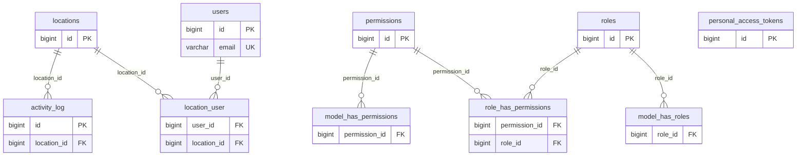
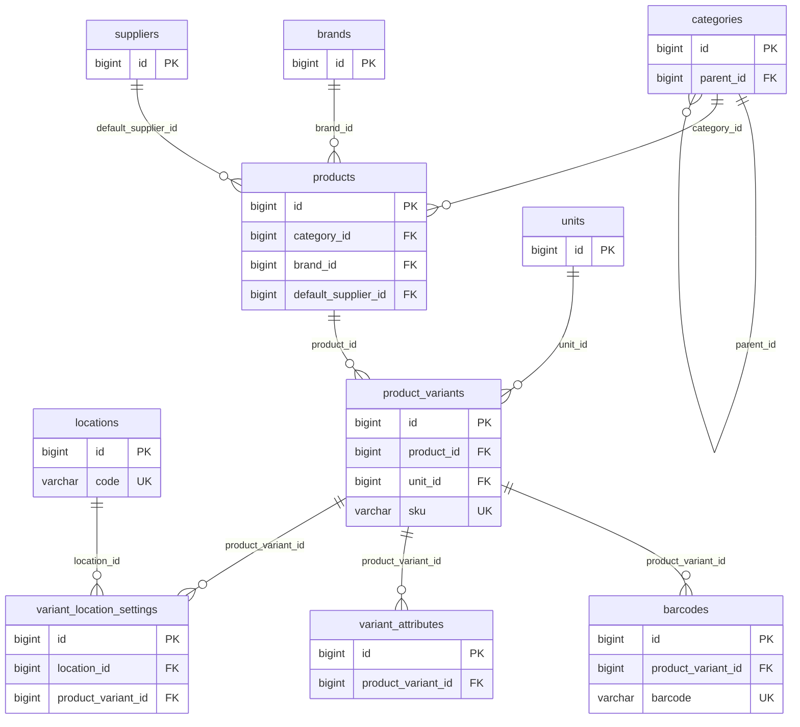
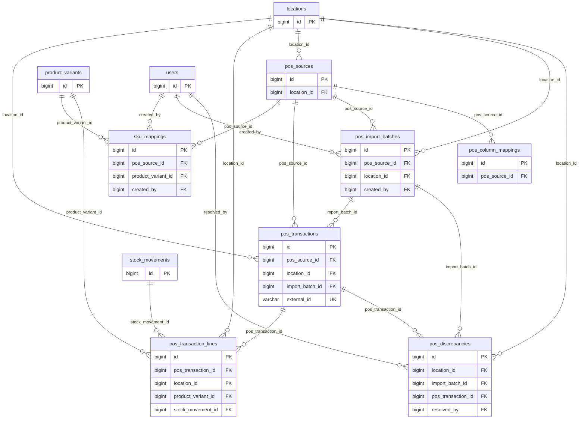
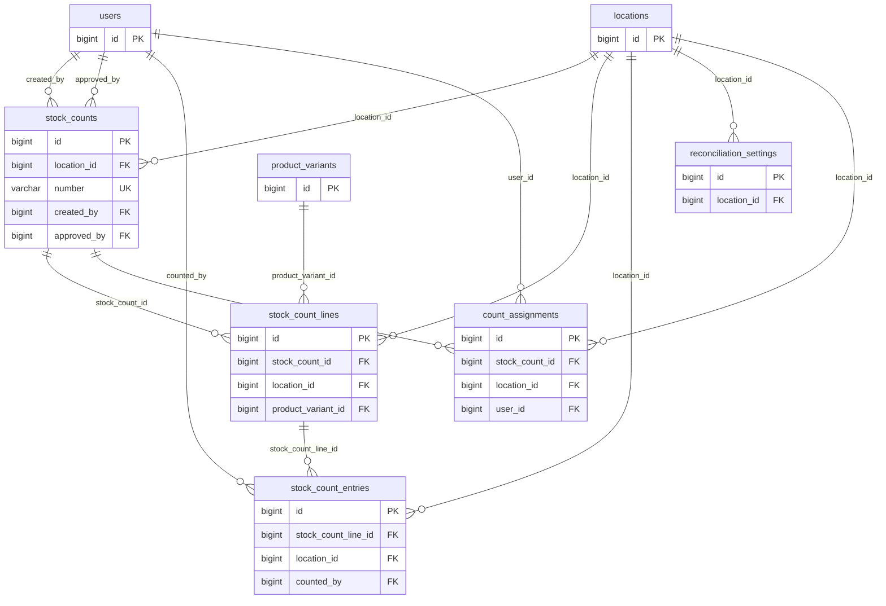
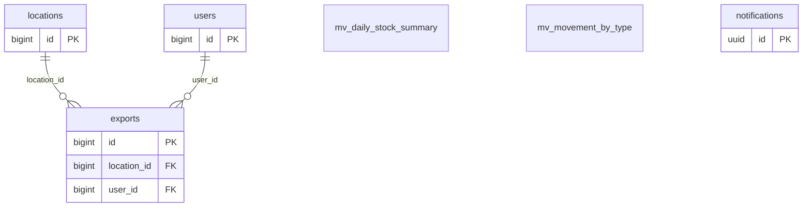

# ERD Fase 1 (v1)

| Item | Detail |
| ---- | ------ |
| Versi | 1.0 — 6 November 2026 (T0.06) |
| Acuan | PRD §6.1.6, §6.1.4–6.1.5; Architecture §3 |
| Detail kolom | [tables.md](tables.md) |

## Konvensi

- PK `bigint generated always as identity`; nomor dokumen manusiawi di kolom `number`.
- Qty `numeric(14,3)`, uang/biaya `numeric(14,4)`, waktu `timestamptz` (UTC); `occurred_at` terpisah dari `created_at`.
- `location_id` wajib di setiap tabel transaksional; FK selalu didefinisikan dengan `ON DELETE RESTRICT`.
- Status = `varchar` + PHP enum + `CHECK`. Soft delete hanya untuk master data.
- `stock_movements` append-only (trigger); `stock_levels` cache; payload eksternal `jsonb`.

## Cakupan

Seluruh 42 tabel PRD §6.1.6 tercakup, ditambah tabel turunan. Total: **50 tabel/view** di bawah, ditambah tabel framework (sessions (driver Redis, tabel tidak dipakai); cache / cache_locks; jobs / job_batches / failed_jobs (queue di Redis; failed_jobs di DB); password_reset_tokens; migrations).

| Sumber | Jumlah | Arti |
| ------ | ------ | ---- |
| PRD | 42 | Ada di daftar PRD §6.1.6 |
| Framework | 4 | Dibutuhkan paket (spatie, Sanctum, notifikasi) |
| Tambahan | 4 | Diturunkan dari AC/Architecture: `document_sequences`, `attachments`, `stock_count_entries`, `exports` |

Tabel *Tambahan* belum ada di PRD §6.1.6; usulan memasukkannya ke PRD pada revisi berikut (perubahan PRD butuh persetujuan).

## Identity

`users`, `roles`, `permissions`, `role_has_permissions`, `model_has_roles`, `model_has_permissions`, `location_user`, `personal_access_tokens`, `activity_log`

## Master

`locations`, `categories`, `brands`, `suppliers`, `units`, `products`, `product_variants`, `variant_attributes`, `barcodes`, `variant_location_settings`

## Inventory

`reason_codes`, `stock_levels`, `stock_movements`, `opening_balances`, `opening_balance_items`, `goods_receipts`, `goods_receipt_items`, `transfers`, `transfer_items`, `returns`, `return_items`, `stock_adjustments`, `stock_adjustment_items`, `document_sequences`, `attachments`

```mermaid
erDiagram
    goods_receipts ||--o{ goods_receipt_items : "goods_receipt_id"
    locations ||--o{ attachments : "location_id"
    locations ||--o{ document_sequences : "location_id"
    locations ||--o{ goods_receipt_items : "location_id"
    locations ||--o{ goods_receipts : "location_id"
    locations ||--o{ opening_balance_items : "location_id"
    locations ||--o{ opening_balances : "location_id"
    locations ||--o{ return_items : "location_id"
    locations ||--o{ returns : "location_id"
    locations ||--o{ stock_adjustment_items : "location_id"
    locations ||--o{ stock_adjustments : "location_id"
    locations ||--o{ stock_levels : "location_id"
    locations ||--o{ stock_movements : "location_id"
    locations ||--o{ transfer_items : "location_id"
    locations ||--o{ transfers : "destination_location_id"
    locations ||--o{ transfers : "location_id"
    opening_balances ||--o{ opening_balance_items : "opening_balance_id"
    product_variants ||--o{ goods_receipt_items : "product_variant_id"
    product_variants ||--o{ opening_balance_items : "product_variant_id"
    product_variants ||--o{ return_items : "product_variant_id"
    product_variants ||--o{ stock_adjustment_items : "product_variant_id"
    product_variants ||--o{ stock_levels : "product_variant_id"
    product_variants ||--o{ stock_movements : "product_variant_id"
    product_variants ||--o{ transfer_items : "product_variant_id"
    reason_codes ||--o{ returns : "reason_code_id"
    reason_codes ||--o{ stock_adjustments : "reason_code_id"
    reason_codes ||--o{ stock_movements : "reason_code_id"
    returns ||--o{ return_items : "return_id"
    stock_adjustments ||--o{ stock_adjustment_items : "stock_adjustment_id"
    stock_movements ||--o{ stock_levels : "last_movement_id"
    stock_movements ||--o{ stock_movements : "reversed_movement_id"
    suppliers ||--o{ goods_receipts : "supplier_id"
    suppliers ||--o{ returns : "supplier_id"
    transfers ||--o{ transfer_items : "transfer_id"
    users ||--o{ attachments : "uploaded_by"
    users ||--o{ goods_receipts : "created_by"
    users ||--o{ opening_balances : "approved_by"
    users ||--o{ opening_balances : "created_by"
    users ||--o{ returns : "created_by"
    users ||--o{ stock_adjustments : "approved_by"
    users ||--o{ stock_adjustments : "created_by"
    users ||--o{ stock_movements : "created_by"
    users ||--o{ transfers : "created_by"
    users ||--o{ transfers : "received_by"
    reason_codes {
        bigint id PK
        varchar code UK
    }
    stock_levels {
        bigint id PK
        bigint location_id FK
        bigint product_variant_id FK
        bigint last_movement_id FK
    }
    stock_movements {
        bigint id PK
        bigint location_id FK
        bigint product_variant_id FK
        bigint reason_code_id FK
        bigint reversed_movement_id FK
        bigint created_by FK
    }
    opening_balances {
        bigint id PK
        bigint location_id FK
        varchar number UK
        bigint created_by FK
        bigint approved_by FK
    }
    opening_balance_items {
        bigint id PK
        bigint opening_balance_id FK
        bigint location_id FK
        bigint product_variant_id FK
    }
    goods_receipts {
        bigint id PK
        bigint location_id FK
        varchar number UK
        bigint supplier_id FK
        bigint created_by FK
    }
    goods_receipt_items {
        bigint id PK
        bigint goods_receipt_id FK
        bigint location_id FK
        bigint product_variant_id FK
    }
    transfers {
        bigint id PK
        bigint location_id FK
        bigint destination_location_id FK
        varchar number UK
        bigint created_by FK
        bigint received_by FK
    }
    transfer_items {
        bigint id PK
        bigint transfer_id FK
        bigint location_id FK
        bigint product_variant_id FK
    }
    returns {
        bigint id PK
        bigint location_id FK
        varchar number UK
        bigint supplier_id FK
        bigint reason_code_id FK
        bigint created_by FK
    }
    return_items {
        bigint id PK
        bigint return_id FK
        bigint location_id FK
        bigint product_variant_id FK
    }
    stock_adjustments {
        bigint id PK
        bigint location_id FK
        varchar number UK
        bigint reason_code_id FK
        bigint created_by FK
        bigint approved_by FK
    }
    stock_adjustment_items {
        bigint id PK
        bigint stock_adjustment_id FK
        bigint location_id FK
        bigint product_variant_id FK
    }
    document_sequences {
        bigint id PK
        bigint location_id FK
    }
    attachments {
        bigint id PK
        bigint location_id FK
        bigint uploaded_by FK
    }
    locations {
        bigint id PK
    }
    product_variants {
        bigint id PK
    }
    suppliers {
        bigint id PK
    }
    users {
        bigint id PK
    }
```

## POS

`pos_sources`, `pos_column_mappings`, `pos_import_batches`, `pos_transactions`, `pos_transaction_lines`, `sku_mappings`, `pos_discrepancies`

## Reconciliation

`reconciliation_settings`, `stock_counts`, `stock_count_lines`, `stock_count_entries`, `count_assignments`

## Reporting

`mv_daily_stock_summary`, `mv_movement_by_type`, `exports`, `notifications`

